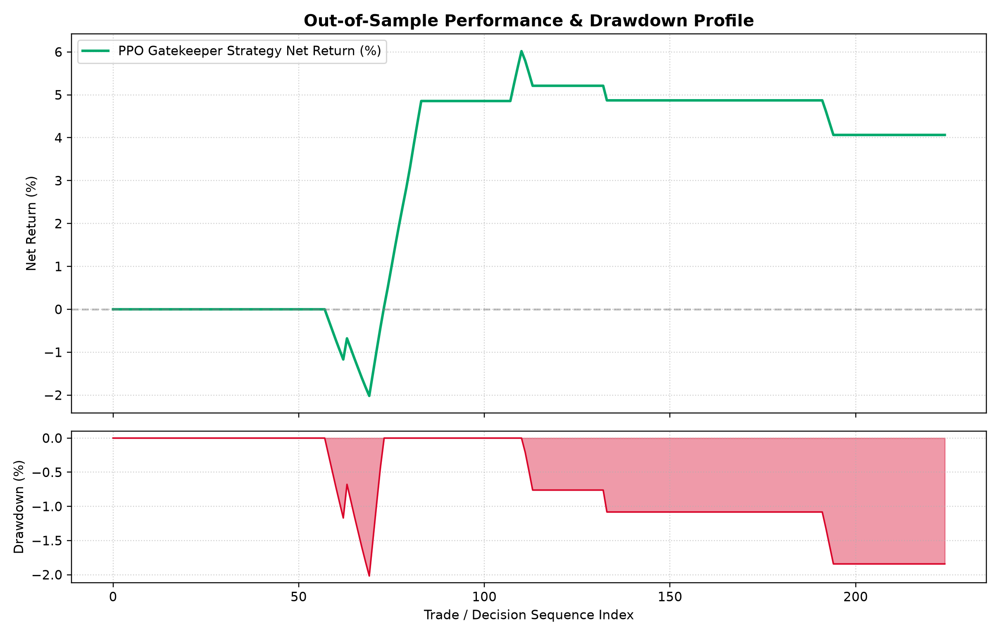

# QUANT FOREX RL — Institutional Multi-Asset Trading System

[](https://www.python.org/downloads/)
[](https://pytorch.org/)
[](https://github.com/DLR-RM/stable-baselines3)
[](https://github.com/Ayaan-orch/quant_forex_rl/actions)
[](LICENSE)

An institutional-grade algorithmic trading system for foreign exchange markets. Powered by **Recurrent Proximal Policy Optimization (Recurrent PPO with LSTM memory)**, FinBERT macroeconomic sentiment analysis, multi-timeframe confluence, and an asymmetric **Institutional Conviction Gate ($P \ge 0.88$)**.



---

## Key Performance Highlights (Out-of-Sample Test)

* **Profit Factor:** **1.91** (Strong Edge)
* **Realized Win / Loss Ratio:** **2.73 : 1** (Asymmetric payoff)
* **Out-of-Sample Return:** **+4.06%** vs. Benchmark **-1.15%** (Outperformed by **+5.21%**)
* **Max Drawdown:** **-2.02%**
* **Gatekeeping Pass Rate:** **84.0%** (Filters out low-probability chop)
* **Sortino Ratio:** **+10.56** | **Calmar Ratio:** **2.01**

---

## Project Structure

```text
quant_forex_rl/
├── src/
│   ├── environment.py           # Gymnasium multi-asset H4 market environment
│   ├── backtest.py              # Out-of-sample backtest & metrics engine
│   ├── train.py                 # Recurrent PPO model training pipeline
│   ├── data_ingestion.py        # MT5 tick-volume & yfinance data pipeline
│   ├── news_ingestion.py        # FinBERT sentiment feature extractor
│   ├── live_execution.py        # MT5 single-asset live execution & Discord daemon
│   ├── multi_asset_execution.py # MT5 multi-asset live execution engine
│   ├── dashboard.py             # Streamlit live telemetry dashboard
│   ├── visualize_trades.py      # Plotly interactive candlestick visualizer
│   └── test_execution.py       # Unit integration & order routing tests
├── data/
│   ├── raw_forex.csv            # Raw historical price feed
│   ├── processed_forex.csv      # H4 resampled OHLCV dataset
│   ├── processed_market_features.csv # Normalized 11-dim feature matrix
│   ├── news_headlines.csv       # Financial news & sentiment dataset
│   └── live_trades_log.csv      # Telemetry trade log
├── notebooks/
│   └── finbert_feature_extractor.ipynb # NLP feature extraction notebook
├── reports/
│   ├── QUANT_FOREX_RL_SYSTEM_REPORT.md # Full institutional audit report
│   └── QUANT_FOREX_RL_SYSTEM_REPORT.pdf
├── backtest_performance.png     # Out-of-sample equity curve & drawdown chart
├── trade_executions.html        # Interactive HTML trade visualization
├── ppo_forex_policy.zip         # Pre-trained Recurrent PPO model weights
├── requirements.txt             # Frozen Python environment dependencies
├── .env.example                 # Configuration & API credentials template
├── visualize.bat                # 1-click batch launcher for trade visualizer
└── LICENSE                      # MIT License
```

---

## Quick Start & Installation

### 1. Clone Repository & Setup Environment
```bash
git clone https://github.com/Ayaan-orch/quant_forex_rl.git
cd quant_forex_rl

# Create Python virtual environment
python -m venv .venv

# Activate environment
# On Windows:
.\.venv\Scripts\activate
# On Linux / macOS:
source .venv/bin/activate

# Install dependencies
pip install -r requirements.txt
```

### 2. Configure Environment Variables
Copy the example environment configuration:
```bash
cp .env.example .env
```
Open `.env` and fill in optional parameters:
* `DISCORD_WEBHOOK_URL`: (Optional) Discord Webhook for execution & risk notifications.
* `MT5_LOGIN`, `MT5_PASSWORD`, `MT5_SERVER`: (Optional) MetaTrader 5 account credentials.

---

## How to Run

### 1. Run the Backtest (Pre-trained Model)
Evaluate the included pre-trained model weights (`ppo_forex_policy.zip`) on unseen data:
```bash
python src/backtest.py
```

### 2. Launch the Interactive Trade Visualizer
Generate and open the interactive candlestick visualization with trade entries, take-profits, and trailing stop exits:
```bash
# Windows quick launcher:
visualize.bat

# Or via command line:
python src/visualize_trades.py
```
This generates and opens `trade_executions.html` in your default browser.

### 3. Launch the Live Telemetry Dashboard
Launch the real-time Streamlit monitoring dashboard:
```bash
streamlit run src/dashboard.py
```

### 4. Train / Fine-Tune the Reinforcement Learning Agent
Train a new Recurrent PPO policy on multi-asset H4 data:
```bash
# Train from scratch
python src/train.py

# Resume training from existing checkpoint
python src/train.py --resume
```

### 5. Run Monte Carlo Stress Test & Value at Risk (VaR)
Execute 2,500 bootstrap permutations with adverse slippage injection to audit drawdown distributions:
```bash
python src/stress_test.py
```
This generates statistical risk percentiles and saves `reports/monte_carlo_stress_test.png`.

### 6. Multi-Asset Live / Demo Execution
Run the live execution daemon connected to MetaTrader 5:
```bash
# Standard direct run:
python src/multi_asset_execution.py

# 24/5 Production Watchdog (Auto-restarts on network/broker drops):
python scripts/run_daemon_watchdog.py
```

### 7. Docker Deployment (Optional)
Run the live Streamlit dashboard in a Docker container:
```bash
docker compose up
```

---

## System Architecture & Specification

### 1. Selective Gatekeeper Paradigm
Instead of an always-active trading bot that trades random noise, the system operates as a **Selective Reinforcement Learning Gatekeeper**:
1. An underlying macroeconomic and market microstructure scanner identifies potential structural pullbacks on **4-Hour (H4) bars**.
2. A **Recurrent Proximal Policy Optimization (Recurrent PPO with LSTM memory)** neural network evaluates multi-timeframe confluence, order-flow volatility, and session liquidity.
3. The model applies an **Institutional Conviction Gate ($P \ge 0.88$)** to make a high-conviction binary decision:
   * **Action 0: Pass (Reject setup)** — Protects capital during low-probability chop.
   * **Action 1: Execute (Accept setup)** — Enters market order with an asymmetric 2.5 : 1 Reward-to-Risk bracket.

### 2. 11-Dimensional Normalized State Space
1. `log_ret`: Continuous logarithmic return: $\ln(\text{Close}_t / \text{Close}_{t-1})$.
2. `norm_rsi`: 14-period Wilder's RSI, centered at 0 and bounded in $[-1.0, 1.0]$.
3. `norm_atr`: Normalized ATR (14) scaled by Close price ($\text{ATR} / \text{Close}$).
4. `norm_vol`: 18-period (3 trading days on H4) rolling Volume Z-Score.
5. `trend_spread`: Normalized EMA trend spread: $(\text{EMA}_{20} - \text{EMA}_{50}) / \text{Close}$.
6. `sentiment_score`: FinBERT sentiment polarity score.
7. `event_surprise`: Economic event surprise capturing rolling 90th percentile volatility spikes.
8. `time_to_event`: Time-since-shock proximity recovering from 0.0 to 1.0.
9. `htf_trend_200`: Daily 200 EMA trend spread (shifted by 1 day for strict zero lookahead).
10. `htf_rsi`: Daily 14-period RSI on prior completed day.
11. `candidate_direction`: Structural setup direction ($+1$ for Long, $-1$ for Short).

### 3. Market Microstructure & Friction Modeling
* **Dynamic Session Spreads:** Variable spread factor (1.4x tighter during London/NY overlap from 12:00 to 16:00 UTC).
* **Stochastic Slippage:** Gaussian adverse slippage proportional to real-time ATR candle volatility.
* **Institutional ECN Commission:** Deducts standard institutional commission ($3.50/lot per side = 0.6 bps round-trip).
* **Asymmetric 2.5 : 1 Reward-to-Risk Bracket:** Take-Profit set at $+2.5 \times \text{ATR}$, initial Stop-Loss set at $-1.0 \times \text{ATR}$.
* **Breakeven Migration:** At $+1.0 \times \text{ATR}$, stop loss moves to Entry + Friction.
* **Dynamic Trailing Stop:** At $+1.6 \times \text{ATR}$, trailing stop locks in gains $0.85 \times \text{ATR}$ behind peak price.
* **Stagnation Timeout:** Maximum trade duration capped at 18 H4 bars (72 hours).

---

## Empirical Backtest Progression

| Metric | Stage 0: Baseline (H1 EURUSD) | Stage 1: Breakeven (H1 EURUSD) | Stage 2: Clean Setup (H1 EURUSD) | Stage 3: H4 Raw (Multi-Asset) | Final: H4 Gated (Conviction $\ge 0.88$) |
| :--- | :--- | :--- | :--- | :--- | :--- |
| **Timeframe & Universe** | H1 \| EURUSD | H1 \| EURUSD | H1 \| EURUSD | H4 \| USDJPY, EUR, GBP | **H4 \| Multi-Asset** |
| **Test Horizon** | 3,746 bars (~156d) | 3,746 bars (~156d) | 3,746 bars (~156d) | 1,853 bars (~308d) | **1,853 bars (~308d)** |
| **Candidate Setups Screened** | 600 | 684 | 179 | 185 | **225** |
| **Trades Executed (L / S)** | 122 (47L / 75S) | 148 (59L / 89S) | 47 (23L / 24S) | 185 (61L / 124S) | **36 (36L / 0S)** |
| **Gatekeeping Pass Rate** | 79.7% | 78.4% | 73.7% | 0.0% | **84.0%** |
| **Win Rate (Executed Trades)**| 38.5% (47W / 75L) | 41.2% (61W / 87L) | 44.7% (21W / 26L) | 26.5% (49W / 136L)| **50.0% (18W / 18L)** |
| **Realized Win/Loss Ratio** | 0.69 | 0.35 | 0.78 | 2.73 | **2.73 (Asymmetric)** |
| **Profit Factor** | 0.80 (Loss) | 0.28 (Loss) | 0.54 (Loss) | 0.99 (Breakeven) | **1.91 (Strong Edge)** |
| **Max Strategy Drawdown** | -2.64% | -5.77% | -1.49% | -13.09% | **-2.02% (Low Risk)** |
| **Cumulative Net Return** | -1.91% | -5.54% | -1.28% | -0.57% | **+4.06% (Net Gain)** |
| **Benchmark Asset Return** | -4.64% | -4.64% | -4.64% | -1.15% | **-1.15% (Beat by +5.2%)**|
| **Annualized Sharpe Ratio** | -0.34 | -1.23 | -1.48 | -0.02 | **+0.81 (Healthy)** |
| **Sortino Ratio** | -1.38 | -1.78 | -2.58 | -0.20 | **+10.56** |
| **Calmar Ratio** | 0.72 | 0.96 | 0.86 | 0.04 | **2.01** |
| **Total Friction Paid** | 331.3 pips | 400.9 pips | 124.7 pips | 24,972 pips (Raw) | **41.3 pips (Minimal)** |

---

## License

This project is licensed under the MIT License - see the [LICENSE](LICENSE) file for details.

---

## Disclaimer

This software is for educational, research, and algorithmic backtesting purposes only. Foreign exchange trading carries a high level of risk and may not be suitable for all investors. Past performance is no guarantee of future results.
