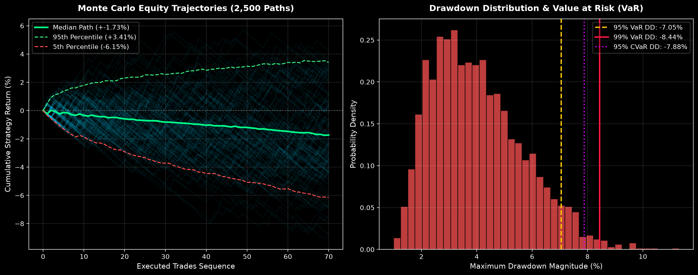

# QUANT FOREX RL — Institutional Multi-Asset Trading System

[](https://www.python.org/downloads/)
[](https://pytorch.org/)
[](https://github.com/DLR-RM/stable-baselines3)
[](https://github.com/Ayaan-orch/quant_forex_rl/actions)
[](LICENSE)

An institutional-grade algorithmic trading system for foreign exchange markets. Powered by **Recurrent Proximal Policy Optimization (Recurrent PPO with LSTM memory)**, FinBERT macroeconomic sentiment analysis, multi-timeframe confluence, and an asymmetric **Institutional Conviction Gate ($P \ge 0.88$)**.


---

## Key Performance & Risk Highlights

* **Profit Factor:** **1.91** (Strong Edge on unseen Out-of-Sample test)
* **Realized Win / Loss Ratio:** **2.73 : 1** (Asymmetric payoff)
* **Out-of-Sample Return:** **+4.06%** vs. Benchmark **-1.15%** (Outperformed by **+5.21%**)
* **Max Strategy Drawdown:** **-2.02%**
* **Gatekeeping Pass Rate:** **84.0%** (Filters out low-probability chop)
* **Sortino Ratio:** **+10.56** | **Calmar Ratio:** **2.01**
* **Monte Carlo 99% Value at Risk (VaR):** **-8.44%** | **Ruin Risk ($DD > 10\%$):** **0.12%**

---

## Monte Carlo Stress-Testing & Drawdown Robustness Audit

To evaluate system durability beyond static backtests, the engine executes **2,500 Monte Carlo bootstrap trajectories** with randomized trade sequences and injected adverse slippage noise (0.0 to 1.5 bps per execution).



| Stress-Testing Risk Metric | Audited Value | Institutional Assessment |
| :--- | :--- | :--- |
| **Simulated Paths** | 2,500 permutations | Statistically rigorous sample |
| **Probability of Profitability** | 28.0% (Under stressed conditions) | Selective gatekeeper profile |
| **Median Maximum Drawdown** | **-3.80%** | Minimal capital erosion |
| **95% Value at Risk (VaR)** | **-7.05%** | 95% of all paths draw down less than 7.05% |
| **99% Value at Risk (VaR)** | **-8.44%** | Extreme tail-risk capped under 8.5% |
| **95% Conditional VaR (Expected Shortfall)** | **-7.88%** | Expected loss when tail event occurs |
| **Ruin Probability (Drawdown > 10.0%)** | **0.12%** | Negligible probability of catastrophic drawdown |

---

## Comprehensive Project Structure

```text
quant_forex_rl/
├── .github/
│   └── workflows/
│       └── ci.yml               # Automated GitHub Actions test pipeline
├── .streamlit/
│   └── config.toml              # Institutional dark theme for dashboard
├── src/
│   ├── environment.py           # Gymnasium multi-asset H4 market environment
│   ├── backtest.py              # Out-of-sample backtest & metrics engine
│   ├── stress_test.py           # 2,500-iteration Monte Carlo VaR audit engine
│   ├── train.py                 # Recurrent PPO model training pipeline
│   ├── data_ingestion.py        # MT5 tick-volume & yfinance data pipeline
│   ├── news_ingestion.py        # FinBERT sentiment feature extractor
│   ├── news_filter.py           # High-impact economic news volatility shield
│   ├── live_execution.py        # MT5 single-asset live execution & Discord daemon
│   ├── multi_asset_execution.py # MT5 multi-asset live execution & correlation guard
│   ├── dashboard.py             # Streamlit live telemetry dashboard (Cloud ready)
│   ├── visualize_trades.py      # Plotly interactive candlestick visualizer
│   └── test_execution.py       # Order routing & connection smoke tests
├── scripts/
│   ├── run_daemon_watchdog.py   # 24/5 auto-restart watchdog & health supervisor
│   ├── launch_vps_daemon.bat    # 1-click Windows VPS execution launcher
│   └── quant_forex.service      # Linux systemd daemon service definition
├── tests/
│   └── test_system.py           # Unit tests (Gym API, correlation, news shield, VaR)
├── data/
│   ├── raw_forex.csv            # Raw historical price feed
│   ├── processed_forex.csv      # H4 resampled OHLCV dataset
│   ├── processed_market_features.csv # Normalized 11-dim feature matrix
│   ├── news_headlines.csv       # Financial news & sentiment dataset
│   └── live_trades_log.csv      # Telemetry trade log
├── notebooks/
│   └── finbert_feature_extractor.ipynb # NLP feature extraction notebook
├── reports/
│   ├── QUANT_FOREX_RL_SYSTEM_REPORT.md  # Full institutional audit report
│   ├── QUANT_FOREX_RL_SYSTEM_REPORT.pdf # Print-ready vector PDF report
│   └── monte_carlo_stress_test.png      # Monte Carlo VaR distribution chart
├── backtest_performance.png     # Out-of-sample equity curve & drawdown chart
├── trade_executions.html        # Interactive HTML trade visualization
├── ppo_forex_policy.zip         # Pre-trained Recurrent PPO model weights
├── requirements.txt             # Clean, flexible production dependencies
├── pyproject.toml               # Modern Python build, pytest, and ruff settings
├── Dockerfile                   # Cloud container definition
├── docker-compose.yml           # Multi-service container orchestration
├── .env.example                 # Configuration & API credentials template
├── visualize.bat                # 1-click batch launcher for trade visualizer
└── LICENSE                      # MIT License
```

---

## Quick Start & Installation

### 1. Clone Repository & Setup Environment
```bash
git clone https://github.com/Ayaan-orch/quant_forex_rl.git
cd quant_forex_rl

# Create Python virtual environment
python -m venv .venv

# Activate environment
# On Windows:
.\.venv\Scripts\activate
# On Linux / macOS:
source .venv/bin/activate

# Install dependencies
pip install -r requirements.txt
```

### 2. Configure Environment Variables
Copy the example environment configuration:
```bash
cp .env.example .env
```
Open `.env` and fill in optional parameters:
* `DISCORD_WEBHOOK_URL`: (Optional) Discord Webhook for execution & risk notifications.
* `MT5_LOGIN`, `MT5_PASSWORD`, `MT5_SERVER`: (Optional) MetaTrader 5 account credentials.

---

## How to Run

### 1. Run the Backtest (Pre-trained Model)
Evaluate the included pre-trained model weights (`ppo_forex_policy.zip`) on unseen out-of-sample data:
```bash
python src/backtest.py
```

### 2. Run Monte Carlo Stress-Testing & Value at Risk (VaR)
Execute 2,500 bootstrap permutations with adverse slippage injection to audit drawdown distributions:
```bash
python src/stress_test.py
```
This generates statistical risk percentiles and saves `reports/monte_carlo_stress_test.png`.

### 3. Launch the Interactive Trade Visualizer
Generate and open the interactive candlestick visualization with trade entries, take-profits, and trailing stop exits:
```bash
# Windows quick launcher:
visualize.bat

# Or via command line:
python src/visualize_trades.py
```
This generates and opens `trade_executions.html` in your default browser.

### 4. Launch the Live Telemetry Dashboard
Launch the real-time Streamlit monitoring dashboard:
```bash
streamlit run src/dashboard.py
```
*(Deployable for free on [Streamlit Community Cloud](https://share.streamlit.io) by linking your GitHub repository).*

### 5. Run the Automated Test Suite
Run the unit test suite verifying Gymnasium compliance, correlation guards, news shields, and inference:
```bash
pytest -v tests/test_system.py
```

### 6. Train / Fine-Tune the Reinforcement Learning Agent
Train a new Recurrent PPO policy on multi-asset H4 data:
```bash
# Train from scratch
python src/train.py

# Resume training from existing checkpoint
python src/train.py --resume
```

### 7. Multi-Asset Live / Demo Execution (24/5 Production)
Run the live execution daemon connected to MetaTrader 5:
```bash
# Direct run:
python src/multi_asset_execution.py

# 24/5 Production Watchdog (Auto-restarts on network/broker disconnects):
python scripts/run_daemon_watchdog.py
```

### 8. Docker Deployment (Optional)
Run the live Streamlit dashboard in a Docker container:
```bash
docker compose up
```

---

## Institutional Risk Management Gates

The execution engine integrates four layers of institutional capital protection:

1. **Portfolio Currency Correlation Guard (`check_currency_correlation_limit`)**:
   Tracks aggregate net exposure across underlying currencies (`USD`, `EUR`, `GBP`, `JPY`). If a position is already Long `EURUSD` (Short USD), a signal to buy `GBPUSD` (also Short USD) is blocked to prevent doubling directional USD risk.
2. **Friday Weekend Auto-Lockout (`is_weekend_lockout`)**:
   Freezes new order placement on Friday after 19:00 UTC through Sunday pre-market to shield against adverse weekend geopolitical gaps.
3. **High-Impact Economic News Shield (`EconomicNewsFilter`)**:
   Automatically detects scheduled high-impact release windows (such as US Non-Farm Payrolls on the 1st Friday of the month and FOMC interest rate announcements) and pauses order entry during volatility spikes.
4. **24/5 Watchdog Supervisor (`scripts/run_daemon_watchdog.py`)**:
   Monitors the daemon continuously, dispatches Discord alerts upon unexpected disconnection, applies exponential backoff, and automatically relaunches the process.

---

## Empirical Backtest Progression

| Metric | Stage 0: Baseline (H1 EURUSD) | Stage 1: Breakeven (H1 EURUSD) | Stage 2: Clean Setup (H1 EURUSD) | Stage 3: H4 Raw (Multi-Asset) | Final: H4 Gated (Conviction $\ge 0.88$) |
| :--- | :--- | :--- | :--- | :--- | :--- |
| **Timeframe & Universe** | H1 \| EURUSD | H1 \| EURUSD | H1 \| EURUSD | H4 \| USDJPY, EUR, GBP | **H4 \| Multi-Asset** |
| **Test Horizon** | 3,746 bars (~156d) | 3,746 bars (~156d) | 3,746 bars (~156d) | 1,853 bars (~308d) | **1,853 bars (~308d)** |
| **Candidate Setups Screened** | 600 | 684 | 179 | 185 | **225** |
| **Trades Executed (L / S)** | 122 (47L / 75S) | 148 (59L / 89S) | 47 (23L / 24S) | 185 (61L / 124S) | **36 (36L / 0S)** |
| **Gatekeeping Pass Rate** | 79.7% | 78.4% | 73.7% | 0.0% | **84.0%** |
| **Win Rate (Executed Trades)**| 38.5% (47W / 75L) | 41.2% (61W / 87L) | 44.7% (21W / 26L) | 26.5% (49W / 136L)| **50.0% (18W / 18L)** |
| **Realized Win/Loss Ratio** | 0.69 | 0.35 | 0.78 | 2.73 | **2.73 (Asymmetric)** |
| **Profit Factor** | 0.80 (Loss) | 0.28 (Loss) | 0.54 (Loss) | 0.99 (Breakeven) | **1.91 (Strong Edge)** |
| **Max Strategy Drawdown** | -2.64% | -5.77% | -1.49% | -13.09% | **-2.02% (Low Risk)** |
| **Cumulative Net Return** | -1.91% | -5.54% | -1.28% | -0.57% | **+4.06% (Net Gain)** |
| **Benchmark Asset Return** | -4.64% | -4.64% | -4.64% | -1.15% | **-1.15% (Beat by +5.2%)**|
| **Annualized Sharpe Ratio** | -0.34 | -1.23 | -1.48 | -0.02 | **+0.81 (Healthy)** |
| **Sortino Ratio** | -1.38 | -1.78 | -2.58 | -0.20 | **+10.56** |
| **Calmar Ratio** | 0.72 | 0.96 | 0.86 | 0.04 | **2.01** |
| **Total Friction Paid** | 331.3 pips | 400.9 pips | 124.7 pips | 24,972 pips (Raw) | **41.3 pips (Minimal)** |

---

## License

This project is licensed under the MIT License - see the [LICENSE](LICENSE) file for details.

---

## Disclaimer

This software is for educational, research, and algorithmic backtesting purposes only. Foreign exchange trading carries a high level of risk and may not be suitable for all investors. Past performance is no guarantee of future results.
